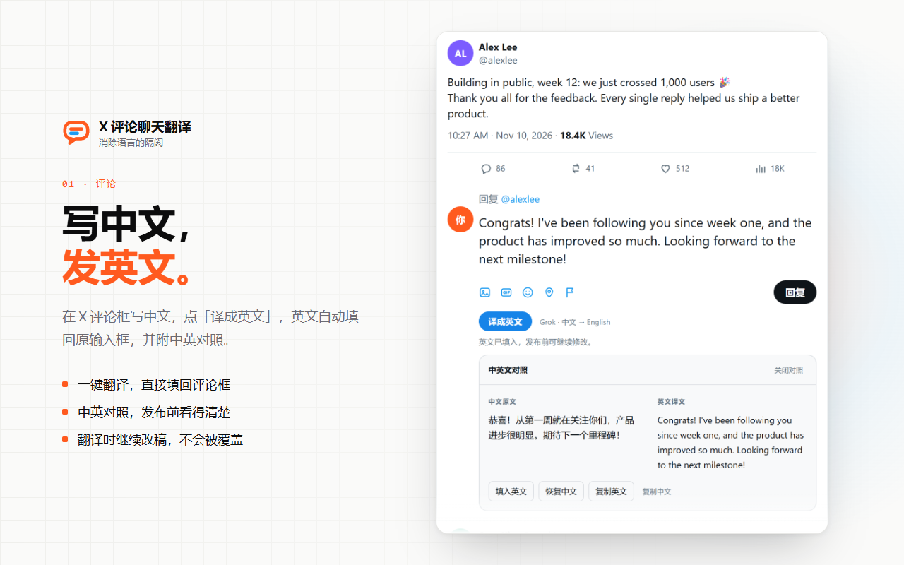
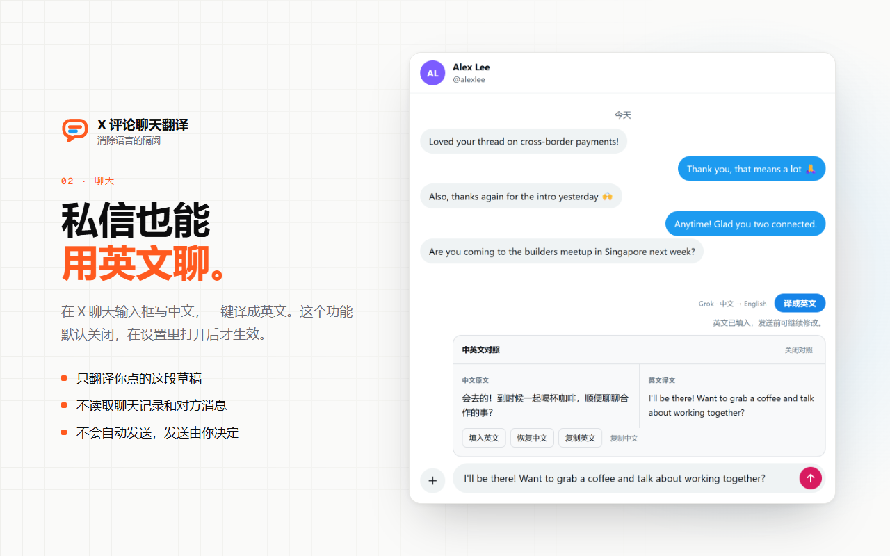

# X 评论聊天翻译

> 消除语言的隔阂

在 X（Twitter）的评论框和私信里写中文，点一下「译成英文」，英文自动填回原输入框，下面附中英对照，核对后由你自己发布。用你自己的 Grok 账号授权，不用填 API Key。

**[Chrome 应用商店安装](https://chromewebstore.google.com/detail/x-%E8%AF%84%E8%AE%BA%E8%81%8A%E5%A4%A9%E7%BF%BB%E8%AF%91/anhdnnldckkhkbkhanfjdmglnhdhhidj)** · 插件主页：<https://zuoye.si/xtranslate/> · 作者：作业借你抄 [@chaozuoye](https://x.com/chaozuoye) · 网站：[zuoye.si](https://zuoye.si/)



## 能做什么

- **评论框中译英**：支持帖子详情页的行内回复，以及时间线点「回复」打开的回复弹窗。
- **中英对照**：译文填回原输入框，下面显示原文和译文，可以复制、恢复中文，或改完再发。
- **私信也能用**：在设置里打开「X 聊天翻译」后，x.com/i/chat 的输入框上方也会出现「译成英文」。默认关闭。
- **不覆盖你的草稿**：翻译期间继续改稿，插件不会自动覆盖，需要你自己点「填入英文」。
- **速度快**：默认选用不推理的 `grok-4.20-0309-non-reasoning`，短句通常一两秒就译完。
- **不用天天授权**：登录加密保存在本机；断网或电脑刚唤醒时续期失败，插件会保留登录并自动重试。



## 开源 · 安全

- **只在你点击时发送**：点「译成英文」时才读取这一段草稿，由插件后台直接发给 xAI 的接口（`api.x.ai`，请求设置 `store:false`）。没有作者自己的服务器，没有统计。
- **不读别的内容**：不读取原帖正文、别人的评论、聊天记录、Cookie 或密码。
- **不自动发布**：插件从不替你发布评论，也不替你发送消息。
- **用你自己的账号**：在 xAI 官方页面（`auth.x.ai`）用设备码授权，插件拿不到你的密码。授权页可能显示「Grok Build」：这是 xAI 给第三方工具共用的公开 OAuth 客户端（和 SuperX 插件相同），不是本插件单独注册的身份。
- **凭据加密保存**：刷新凭据用本机生成、不可导出的 AES-GCM 密钥加密后保存，网页读不到。也可以取消「在本机记住登录」，只保留本次浏览器会话。
- **权限很少**：只申请 `storage`、`alarms`，只访问 `x.com`、`twitter.com`、`auth.x.ai`、`api.x.ai`。没有远程代码。
- **安装包可以自己核对**：上传到 Chrome 应用商店的 1.0.0 安装包，可以用 `npm run package` 从这份代码原样打出来，SHA-256 是 `cd8fbcb785dab7b71bca01747f0bbcbeed302d05963e5b0c07a1b5c50c4343b8`。

隐私政策：<https://zuoye.si/xtranslate/privacy/>（插件包里也有一份更详细的 [extension/PRIVACY.md](extension/PRIVACY.md)）

### 代码在哪里

| 文件 | 作用 |
|---|---|
| [`extension/content.js`](extension/content.js)、[`editor-adapter.js`](extension/editor-adapter.js) | 在 X 的回复框和聊天框旁加按钮和对照面板；按 X 的真实页面结构识别输入框，用一次模拟粘贴把译文填回 |
| [`extension/background.js`](extension/background.js)、[`background-controller.js`](extension/background-controller.js) | 扩展后台：只接受插件自己的页面和 x.com 发来的请求，聊天翻译没开启时直接拒绝 |
| [`extension/translation-provider.js`](extension/translation-provider.js) | 调用 xAI `/v1/responses` 翻译，处理超时、限流和 401 |
| [`extension/vendor/`](extension/vendor/) | Grok 设备码登录、凭据续期和本机加密，来自 [SuperX](https://github.com/bwjoke/SuperX)（MIT），有修改，见 [THIRD_PARTY_NOTICES.md](THIRD_PARTY_NOTICES.md) |
| [`extension/options.*`](extension/options.html)、[`popup.*`](extension/popup.html) | 设置页和弹窗 |

## 安装

**Chrome 应用商店**（推荐，以后自动更新）：<https://chromewebstore.google.com/detail/x-%E8%AF%84%E8%AE%BA%E8%81%8A%E5%A4%A9%E7%BF%BB%E8%AF%91/anhdnnldckkhkbkhanfjdmglnhdhhidj>

> 开启了 Chrome「增强型保护」时，安装可能提示「增强型安全浏览功能不信任此扩展程序」。这是 Chrome 对新开发者账号的常规提示，不代表插件有风险，点「继续安装」即可。

**从源码安装**（Chrome 120 或更高版本，Edge 等 Chromium 内核浏览器同样可以）：

1. 点这个页面右上方绿色的 **Code → Download ZIP**，下载后解压。
2. 浏览器打开 `chrome://extensions`，打开右上角「开发者模式」。
3. 点「加载已解压的扩展程序」，选择解压出来的文件夹里的 **`extension`** 文件夹（直接包含 `manifest.json` 的那个，不是最外层文件夹）。
4. 点工具栏里的插件图标 →「连接 Grok」，核对短码后前往 xAI 官方页面授权。
5. 刷新 x.com，在评论框写中文，点「译成英文」。

> 需要你自己的 xAI / Grok 账号。翻译调用的是 xAI 的接口，用量、费用和可用模型以你的账号实际情况为准；普通订阅不一定包含所需的接口权限。用量可以在 [Grok 用量页](https://grok.com/dashboard/usage) 查看。

## 使用说明

- 翻译成功后先显示中文原文和英文译文，再把英文填回同一个输入框。填入结果和译文不一致时会提示核对，可以按 Ctrl+Z 撤销。
- 行内回复被 X 的回复弹窗或图片查看器遮住时，结果保留在面板里，关闭弹窗后可以点「填入英文」。
- 英文填入后再手动改过，「恢复中文」就不能用了，但仍可以复制中文。
- 多个评论框各自独立。切换页面、关闭评论框、换了回复对象或退出登录，会丢弃旧的翻译结果。
- 单次最多 8,000 字，可以中英混合。不支持普通发帖、引用发帖、其他网站和英文译中文。
- 超时、权限不足、限流等情况会保留草稿，需要你手动重试；已经发出的翻译请求不会自动重发。

**没有按钮？** 先确认是在帖子详情页的行内回复或回复弹窗里（普通发帖没有按钮），装好或更新插件后要刷新 X。想核对实际运行的版本，可以在 X 页面按 F12，在控制台执行 `document.querySelector('grok-input-panel')?.dataset.version`。

## 开发

Node.js 22+。插件本身不需要构建，也没有运行时依赖。

```bash
npm ci
npm run validate                 # 清单、语法、依赖文件哈希检查和 Node 单元测试
npm run test:browser             # 把插件装进 Edge/Chromium，在模拟的 x.com 上验证（默认用本机 Edge，可用 BROWSER_PATH 指定浏览器）
npm run demo                     # 本地交互演示 http://127.0.0.1:4173/alice/status/123（固定的模拟译文，不连 Grok）
npm run package                  # 打包 dist/grok-input-translator-<版本>.zip（只含插件文件，根目录就是 manifest.json）
node tools/make-icons.cjs        # 重新生成图标
node store/src/render.cjs        # 重新生成商店截图和宣传图（真实插件 + 模拟登录）
```

更新记录见 [CHANGELOG.md](CHANGELOG.md)。

## English

**X 评论聊天翻译** (a reply and chat translator for X) is a Chrome extension. Write Chinese in an X reply box, or in an X Chat message box if you turn that on, click 译成英文 (Translate to English), and the English is filled back into the same box with a side-by-side comparison. You post it yourself.

It signs in with your own Grok account through xAI's official device sign-in (no API key), sends only the draft you choose straight to the xAI API, has no server of its own and collects nothing. The UI is in Chinese.

Not an official X or xAI product; not affiliated with X Corp. or xAI.

## 许可

[MIT](LICENSE)。`extension/vendor/` 下的文件来自 SuperX，同样是 MIT 许可，版权声明和修改说明见 [THIRD_PARTY_NOTICES.md](THIRD_PARTY_NOTICES.md) 和 [extension/vendor/LICENSE-SuperX.txt](extension/vendor/LICENSE-SuperX.txt)。
